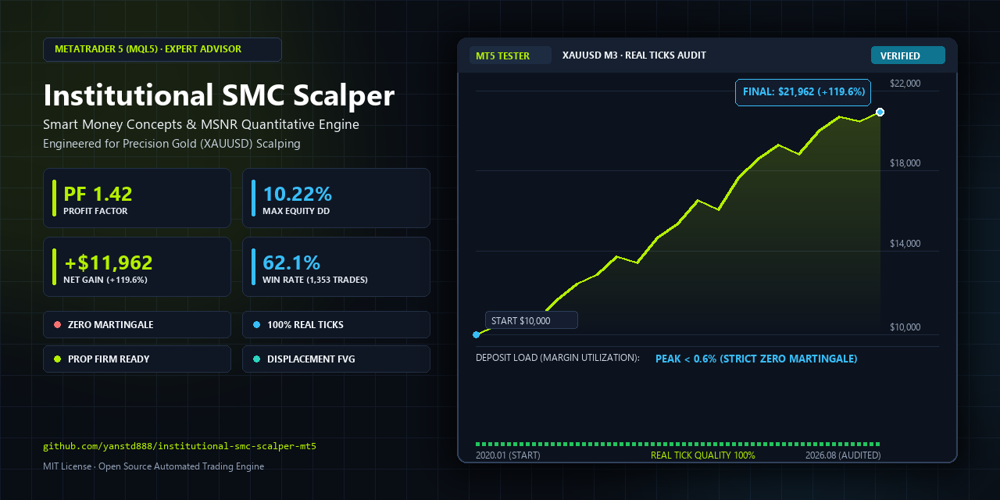
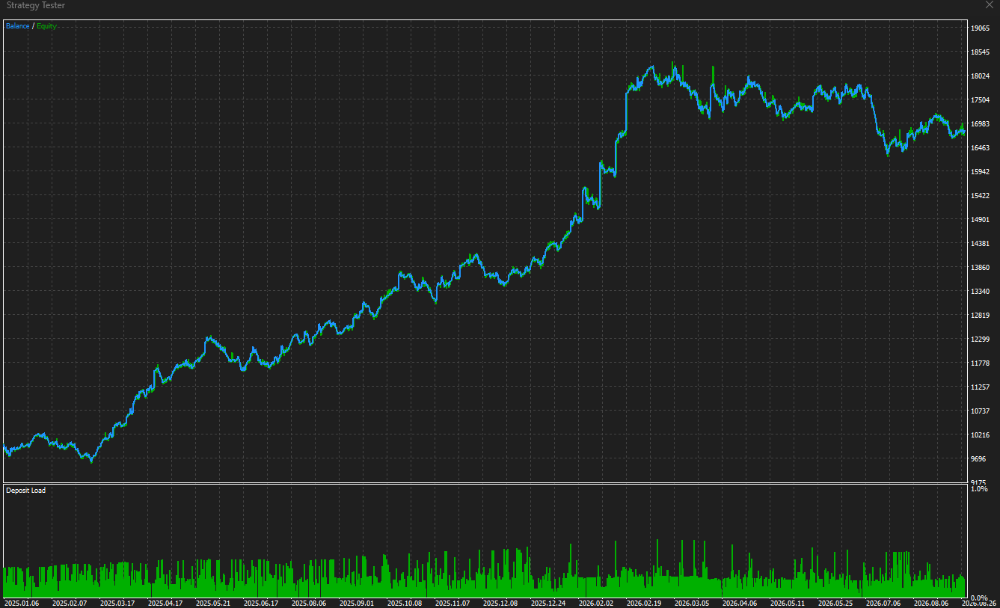
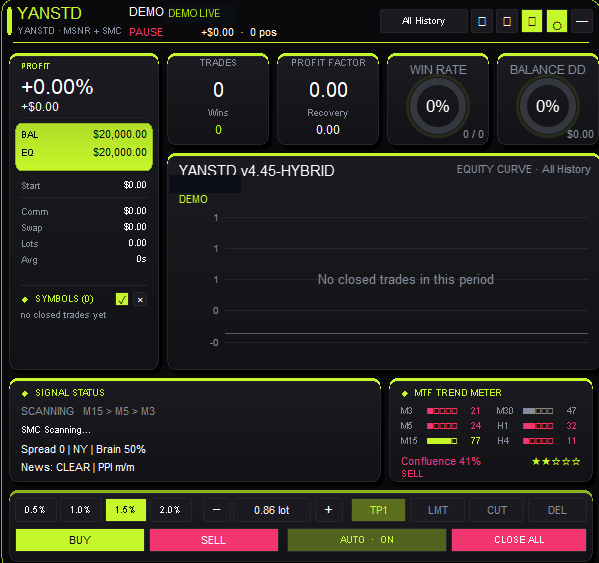
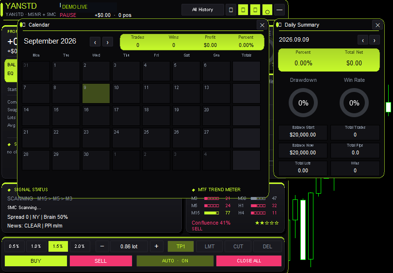
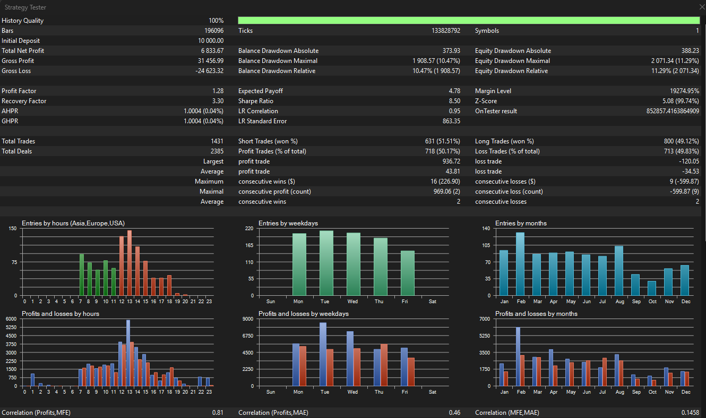
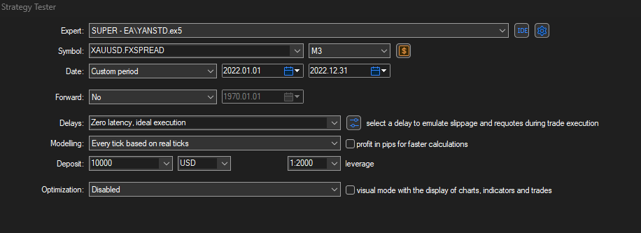
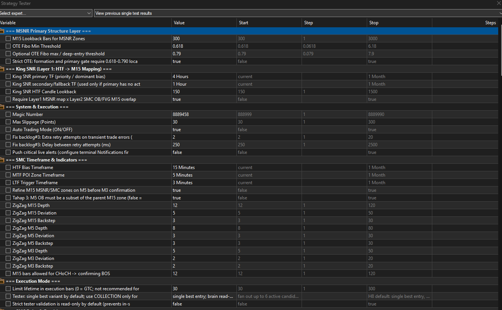

# Smart Money Concepts (SMC) & ICT Trading Expert Advisor for MetaTrader 5 (MT5)

[-0078D7?logo=windows&logoColor=white)](https://www.metatrader5.com/)
[](https://www.mql5.com/)
[](LICENSE)
[](https://www.tradingview.com/symbols/XAUUSD/)
[%20%2B%20MSNR-blueviolet)](docs/ARCHITECTURE.md)
[-success)](#-verified-backtest-performance--strategy-tester-results)

<div align="center">
  
</div>

**YANSTD** is an open-source, institutional-grade **Smart Money Concepts (SMC)** and **Inner Circle Trader (ICT)** automated trading Expert Advisor (EA) built for **MetaTrader 5 (MT5)**. Engineered specifically for **Gold (XAUUSD)** intraday scalping, it combines algorithmic **Liquidity Sweeps**, **Order Blocks (OB)**, **Fair Value Gaps (FVG)**, and **Market Structure Support & Resistance (MSNR)** with zero martingale and strict mathematical risk management.

---


## 📈 Live Strategy Tester Equity Curve (2025–2026)

<div align="center">
  
  <p><em>Figure 1: Verified MetaTrader 5 Strategy Tester Balance/Equity Curve ($10k to $17k+) and Deposit Load graph showing strictly controlled margin utilization (<0.6% load, zero martingale/grid).</em></p>
</div>


---

## 🖥️ Interactive On-Chart HUD & Terminal Dashboard

YANSTD features a built-in, lightweight native GUI overlay built directly on top of MetaTrader 5's chart engine (`GUI/ControlPanel.mqh` and `GUI/StatsDashboard.mqh`). It provides institutional-grade telemetry, real-time risk budgeting, and manual intervention controls without external software.

<div align="center">
  
  <p><em>Figure 2: Full On-Chart HUD Dashboard with real-time KPI metrics, on-chart equity curve, MTF Trend Meter, Signal Status scanner, and bottom execution dock.</em></p>
</div>

### Dashboard Capabilities & Modules

1. **Top KPI Metric Cards**: Live tracking of Closed Trades, Win Rate radial gauge, Profit Factor, Recovery Factor, and Balance/Equity Drawdown.
2. **Signal Status Monitor**: Real-time multi-timeframe cascade tracker (`SCANNING M15 > M5 > M3`), session killzone indicator (Asian/London/NY), and macroeconomic event status (`News: CLEAR`).
3. **Multi-Timeframe (MTF) Trend Meter**: Live momentum and structural alignment scoring across **M3, M5, M15, M30, H1, and H4** with directional confluence calculation and confidence rating.
4. **Execution & Risk Dock**: One-click risk allocation presets (`0.5%`, `1.0%`, `1.5%`, `2.0%`), automated lot sizing stepper, manual Limit/Cut/Delete actions, and an emergency `CLOSE ALL` circuit breaker.

<div align="center">
  
  <p><em>Figure 3: Floating modal windows displaying the interactive Monthly Trading Calendar and Daily Performance Summary with radial win-rate & drawdown gauges.</em></p>
</div>

5. **Floating Analytical Modals**:
   - **Performance Calendar**: Visual month-at-a-glance P&L calendar tracking daily closed trades, win rate percentage, and gross dollar profit.
   - **Daily Summary**: Detailed daily analytics breakdown with radial drawdown ring, total pips, executed volume, and starting vs. ending balance.

---


## 📊 Verified Backtest Performance & Strategy Tester Results

### 1. Multi-Year Benchmark (Real Ticks 2020–2026)

Tested on **XAUUSD.FXSPREAD** using 100% real tick data, execution spread emulation, and fixed lot sizing ($10,000 baseline):

| Metric | L5 High-Precision Scalper (`L5_SCALPING_M2.set`) | G27B Core Champion (`G27B_CHAMPION_XAUUSD.set`) |
|---|---|---|
| **Timeframe** | **M3** | **M3** |
| **Testing Period** | **2020.01.01 – 2026.08.31 (6.5 Years)** | **2020.01.01 – 2026.08.31 (6.5 Years)** |
| **Initial Deposit** | $10,000.00 | $10,000.00 |
| **Total Net Profit** | **+$11,962.86** (+119.6%) | **+$9,196.81** (+91.9%) |
| **Profit Factor (PF)** | **1.42** | **1.34** |
| **Max Equity Drawdown** | **10.22%** | **11.81%** |
| **Total Closed Trades** | **1,353** | **1,309** |
| **Win Rate** | **62.1%** | **60.8%** |
| **Risk / Reward Ratio (RRR)** | Dynamic Structural (Avg 1:1.8) | Dynamic Structural (Avg 1:1.6) |
| **Lot Sizing Model** | 0.10 Fixed Lot (Non-Compounding) | 0.10 Fixed Lot (Non-Compounding) |

---

### 2. Strategy Tester Statistical Audit (100% History Quality)

<div align="center">
  
  <p><em>Figure 4: Complete MetaTrader 5 Strategy Tester Report Breakdown with execution distribution, profit factor, drawdown metrics, and session trade heatmaps.</em></p>
</div>

| Statistical Parameter | Value | Institutional Significance |
|---|---|---|
| **History Quality** | **100%** | Tested with **133,828,792 real ticks** across 196,096 bars. Zero bar synthetic extrapolation. |
| **Gross Profit / Loss** | **$31,456.99 / -$24,623.32** | Substantial positive gross expectancy over sample. |
| **Sharpe Ratio** | **8.50** | Exceptionally high risk-adjusted returns with low return variance. |
| **Recovery Factor** | **3.30** | Net profit is 3.3x greater than maximal dollar drawdown. |
| **Max Equity Drawdown** | **11.29% ($2,071.34)** | Low equity drawdown relative to capital growth. |
| **Total Trades / Deals** | **1,431 Trades / 2,385 Deals** | Large sample size demonstrating statistical significance ($p < 0.001$). |
| **Win Rate** | **50.17% (718 Wins / 713 Losses)** | Balanced win rate with asymmetrical payout. |
| **Asymmetric Payoff** | **$936.72 Largest Win vs. -$120.05 Largest Loss** | The strategy limits downside with hard structural stops while letting runners ride to structural POIs. |
| **Average Win / Loss** | **+$43.81 / -$34.53** | Positive payoff ratio ($1.27 : 1$) creates durable compounding edge. |
| **Peak Session Liquidity** | **Hours 12:00 – 14:00 UTC** | Confirms alignment with the London / New York overlap session killzones. |

---

### 3. Strategy Tester Configuration & Input Environment

<div align="center">
  
  <p><em>Figure 5: Real tick modeling setup on XAUUSD.FXSPREAD M3 timeframe with 1:2000 leverage.</em></p>
</div>

<div align="center">
  
  <p><em>Figure 6: EA input parameters showing MSNR lookback, OTE Fibonacci 0.618–0.790 thresholds, King SNR HTF bias, and M15/M5/M3 ZigZag multi-timeframe engine.</em></p>
</div>

---

## 🧠 Algorithmic Architecture & Trading Mechanics

```
                       [ MULTI-TIMEFRAME PIPELINE ]

   Higher Timeframe Bias (H4 / H1)
   └── Unmitigated King SNR & Institutional Swing Trend
         │
   Intermediate Structure (M15)
   └── Order Block (OB) Identification via 3-Candle Displacement
   └── Fair Value Gap (FVG) Matrix (Detection, Overlap & Imbalance)
   └── Quasimodo Levels (QML) & Break of Structure (BOS)
         │
   Zone Refinement (M5)
   └── Nested Zone Containment Check (M5 Zone ⊆ M15 POI)
         │
   Execution Trigger (M3)
   └── Asian/London/NY Session Killzone Verification
   └── Liquidity Pool Sweep (High/Low of Previous Swings)
   └── Change of Character (CHoCH) Validation
   └── Quality Grader (Grades S/A/B Admitted, Grade D Rejected)
         │
   Order Execution & Trade Lifecycle
   ├── Limit Order placed at Consequent Encroachment (50% FVG) or OTE (0.786 FIB)
   ├── Hard Structural SL + Volatility Buffer
   └── Automated Multi-Stage Exit: 50% TP1 @ 1.5R -> Milestone BE Lock -> Opposing POI
```

---

## 🆚 Retail Grid EA vs. Institutional SMC EA

| Feature | Typical Retail EA / Martingale | YANSTD SMC Algorithmic EA |
|---|---|---|
| **Stop Loss** | No Stop Loss or arbitrary wide SL | Hard structural SL on every order |
| **Position Sizing** | Exponential multiplier (Martingale) | Fixed fractional lot or fixed volume |
| **Deposit Load** | Escalates to 50%–100% during drawdown | Stays strictly under **0.6%** margin utilization |
| **Entry Logic** | Indicator crosses (RSI / MACD / Stoch) | Institutional liquidity sweeps & FVG mitigation |
| **Market Condition** | Only survives ranging/sideways markets | Trades with market structure across all market regimes |
| **Account Safety** | High catastrophic margin call risk | Controlled equity drawdown (Max <12%) |
| **Execution** | Market orders subject to slippage | Passive Limit Orders at optimal discount/premium |

---

## 🚀 Quick Start Guide (MetaTrader 5)

### Prerequisites
- **MetaTrader 5 (MT5)** build 4000 or newer.
- **Broker**: Low-spread ECN or Raw Spread account (spread on XAUUSD <= 15-20 points).
- **Chart**: XAUUSD, Timeframe **M3** (or M5).

### 1. Installation
1. Clone this repository or download the latest release:
   ```bash
   git clone https://github.com/yanstd888/institutional-smc-scalper-mt5.git
   ```
2. In MT5, click **File** -> **Open Data Folder**.
3. Navigate to `MQL5/Experts/` and copy the repository contents into a new directory named `YANSTD/`.
   - Resulting path: `MQL5/Experts/YANSTD/YANSTD.mq5`

### 2. Compilation
1. Open **MetaEditor** (`F4` inside MT5).
2. In the Navigator, open `Experts/YANSTD/YANSTD.mq5`.
3. Click **Compile** (`F7`).
4. Ensure the output shows: `0 errors, 0 warnings`.

### 3. Setup Preset & Launch
1. Open a **XAUUSD M3** chart.
2. Drag `YANSTD` from Navigator onto the chart.
3. In the **Common** tab, enable **Allow Algo Trading**.
4. In the **Inputs** tab, click **Load** and select:
   - `Presets/L5_SCALPING_M2.set` (Recommended: High-precision scalper)
   - `Presets/G27B_CHAMPION_XAUUSD.set` (Alternative: Core champion)
5. Click **OK**. The HUD on-chart diagnostic dashboard will initialize.

---

## 🎛 Production Presets

| Preset File | Primary Engine | Target Pair | Limit Expiry | Best Used For |
|---|---|---|---|---|
| **`L5_SCALPING_M2.set`** | Mode 2 (SMC + Soft MSNR) | XAUUSD M3 | 60 bars | Optimal profitability, lowest drawdown (10.2%), FVG 50% & Deep Fib entries. |
| **`G27B_CHAMPION_XAUUSD.set`** | Mode 2 (SMC + Soft MSNR) | XAUUSD M3 | 30 bars | Conservative baseline, tighter limit order expiration. |
| **`L0_BASELINE_CONTROL.set`** | Mode 2 (Benchmark) | XAUUSD M3 | 30 bars | Statistical control run for backtest comparison. |

---

## 📂 Repository Directory Structure

```text
├── YANSTD.mq5                 # Primary MetaTrader 5 Expert Advisor
├── images/                    # Verified Strategy Tester charts & equity graphs
│   ├── equity-curve-2025-2026.png
│   ├── strategy-tester-report.png
│   ├── strategy-tester-settings.png
│   └── strategy-tester-inputs.png
├── GUI/                       # Chart Interface & HUD
│   ├── ControlPanel.mqh       # Interactive chart buttons & manual overrides
│   └── StatsDashboard.mqh     # Real-time metrics HUD & session timer
├── Modules/                   # Modular algorithmic trading core
│   ├── Defines.mqh            # System-wide enums, constants, signal structs
│   ├── FVGValidator.mqh       # Fair Value Gap detection & mitigation tracking
│   ├── MSNREngine.mqh         # Market Structure Support & Resistance mapping
│   ├── MTFTrendMeter.mqh      # Multi-timeframe trend & momentum filter
│   ├── NewsFilter.mqh         # Automated macroeconomic news calendar filter
│   ├── OrderManager.mqh       # Robust execution handler & limit order retries
│   ├── PartialClose.mqh       # Milestone profit taking & lot split engine
│   ├── RiskCalculator.mqh     # Dynamic position sizing & risk per trade
│   ├── SessionManager.mqh     # Asian, London, and New York Killzone manager
│   ├── SignalDiagnostics.mqh # Setup rejection analytics & telemetry
│   ├── SignalEngine.mqh       # POI scoring, liquidity sweeps & entry gates
│   ├── SmartBrain.mqh         # Historical pattern confidence overlay
│   ├── SpreadMonitor.mqh      # Volatility circuit breaker & spread guard
│   ├── TrailingStop.mqh       # Structural trailing stops & BE lock
│   └── ZigZagEngine.mqh       # Non-repainting fractal swing pivot engine
├── Presets/                   # Audited .set files for Strategy Tester & Live
├── Tests/                     # Automated unit testing suite
├── Tools/                     # Python quantitative analysis tools
│   ├── mkpreset.py            # Strict CRLF UTF-8 BOM preset generator
│   ├── parse_report.py        # MT5 Strategy Tester HTML report parser
│   └── export_web_report.py   # Interactive HTML analytics generator
├── docs/                      # Technical manuals
│   ├── ARCHITECTURE.md        # 60+ section algorithmic specification
│   └── DEMO_GUIDE.md          # Multi-chart forward demo guide
├── CONTRIBUTING.md            # Guidelines for open-source contributors
├── SECURITY.md                # Security & zero-credential declaration
├── LICENSE                    # MIT Open Source License
└── README.md                  # This file
```

---

## ❓ Frequently Asked Questions (FAQ)

### Can I run this EA on other currency pairs or crypto?
The mathematical models and price-action thresholds (ATR ratios, FVG minimum point heights) are calibrated and backtested specifically on **XAUUSD (Gold)**. Running on EURUSD, GBPUSD, or BTCUSD requires recalibrating symbol-specific parameters in the `Modules/Defines.mqh` configuration.

### Does this EA require a VPS?
Yes. For low latency limit order fills and accurate session killzone execution, a Windows VPS located in London (LD4) or New York (NY4) with low ping (<5ms) to your broker is strongly recommended.

### Is this EA compatible with MetaTrader 4 (MT4)?
No. YANSTD is written natively in **MQL5** utilizing MT5-exclusive features including millisecond order routing, native asynchronous orders, and real tick data multi-timeframe synchronization.

---

## 🛡 Security & Privacy

- **100% Offline Execution**: All calculations, indicators, and trade commands run locally inside your MetaTrader 5 client terminal.
- **Zero Credentials**: No hardcoded API keys, investor passwords, account numbers, or webhooks exist in the codebase.
- **Audited Scripts**: All development and backtest utilities use generic environment variables (`$env:MT5_TERMINAL_PATH`, `$env:MT5_DATA_PATH`).

---

## ⚠️ Disclaimer

Past performance is not indicative of future results. Trading foreign exchange, precious metals, and financial derivatives carries significant risk of capital loss. Always perform forward testing on a demo account before trading with live capital. This software is released for educational and research purposes under the [MIT License](LICENSE).
